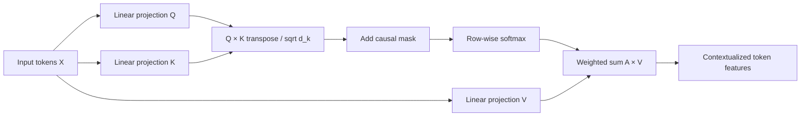

# Lesson 1 — Self-Attention from First Principles

## 1. Intuition
Self-attention lets each token form a context-dependent weighted combination of token representations. Unlike a fixed convolution kernel, attention weights depend on the input content. In a Vision Transformer, image patches play the role of tokens.

## 2. Shapes and equations
For a batch of token embeddings `X ∈ R^{B×T×d_model}`, learn projections:

$$
Q=XW_Q,\quad K=XW_K,\quad V=XW_V
$$

where `W_Q, W_K ∈ R^{d_model×d_k}` and `W_V ∈ R^{d_model×d_v}`.

$$
S=\frac{QK^\top}{\sqrt{d_k}},\qquad A=\operatorname{softmax}(S+M),\qquad Y=AV.
$$

Here softmax is applied across the **key** dimension. `M_{ij}=0` for permitted attention and `-∞` for forbidden positions. In causal attention, token `i` cannot attend to future positions `j>i`.

### Why scale by sqrt(d_k)?
If query and key components are independent, centered and unit-variance, their dot product has variance approximately `d_k`. Dividing by `sqrt(d_k)` keeps logit magnitudes better behaved, reducing softmax saturation.

## 3. Visual flow



For a 4-token sequence, the causal permission matrix (1 = allowed) is:

```text
       key:  0  1  2  3
query 0     1  0  0  0
query 1     1  1  0  0
query 2     1  1  1  0
query 3     1  1  1  1
```

## 4. Minimal working PyTorch implementation

```python
import math
import torch
import torch.nn.functional as F

def causal_self_attention(x, wq, wk, wv):
    # x: [batch, tokens, d_model]
    q, k, v = x @ wq, x @ wk, x @ wv
    t, dk = q.shape[-2], q.shape[-1]
    logits = (q @ k.transpose(-2, -1)) / math.sqrt(dk)
    blocked = torch.ones(t, t, device=x.device, dtype=torch.bool).triu(1)
    logits = logits.masked_fill(blocked, float("-inf"))
    weights = F.softmax(logits, dim=-1)
    return weights @ v, weights

torch.manual_seed(7)
x = torch.randn(2, 4, 8)
wq, wk, wv = [torch.randn(8, 8) / math.sqrt(8) for _ in range(3)]
y, a = causal_self_attention(x, wq, wk, wv)
assert y.shape == (2, 4, 8)
assert torch.allclose(a.sum(-1), torch.ones(2, 4), atol=1e-6)
assert torch.all(a.triu(1) == 0)
print("output:", y.shape, "attention:", a.shape)
```

**Important:** This is a pedagogical single-head implementation, not an optimized production kernel. Modern implementations commonly use fused scaled-dot-product attention.

## 5. Complexity
For sequence length `T` and per-head dimensions `d_k ≈ d_v = d`, forming attention scores and weighted sums costs `O(T²d)` operations and materializing the attention matrix costs `O(T²)` memory per batch/head. FlashAttention changes the memory traffic and avoids materializing the full matrix; it does not remove the quadratic arithmetic of exact dense attention.

## 6. Experiments
1. Remove the scale factor and measure attention entropy as `d_k` increases.
2. Remove the causal mask: verify future tokens influence earlier outputs.
3. Compare attention heatmaps for text tokens and image-patch tokens.
4. Replace the implementation with `torch.nn.functional.scaled_dot_product_attention(q, k, v, is_causal=True)` and compare outputs within tolerance.

## 7. Knowledge check
**Question:** Why is self-attention alone permutation equivariant without positional information? Explain how positional encodings break this symmetry.

## References
- Vaswani et al., [Attention Is All You Need](https://arxiv.org/abs/1706.03762), 2017.
- Dosovitskiy et al., [An Image is Worth 16x16 Words](https://arxiv.org/abs/2010.11929), 2020.
- Dao et al., [FlashAttention](https://arxiv.org/abs/2205.14135), 2022.

[Chapter index](README.md)
